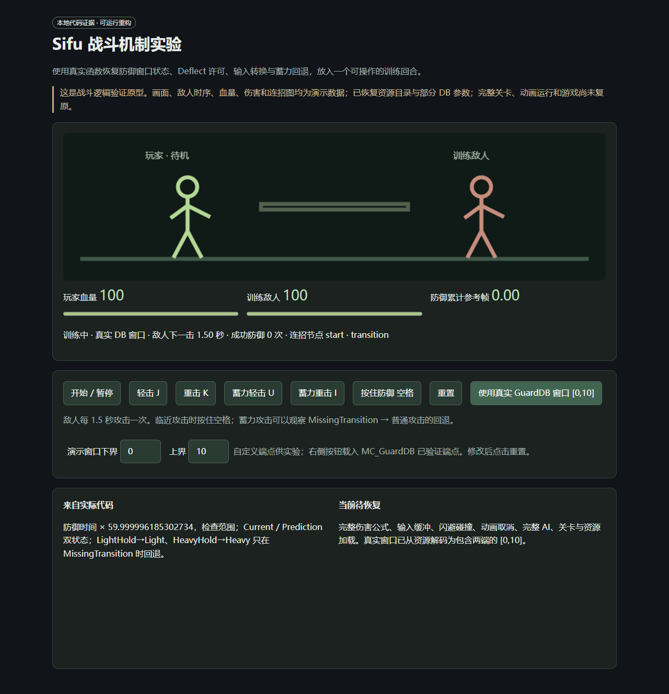

# 用 REA 分析与重构 Sifu：整合研究报告

本轮在 Windows 游戏安装旁，用 WSL 中的 REA、Ghidra 和匹配 PDB 做静态分析，恢复资源目录和部分资源数据，并将有证据的逻辑改写成可运行组件。**完整 Sifu 尚未复原，也没有得到可以重新编译原作的完整 UE4 源码工程。** 以下记录已验证的成果、原型操作方式、文件结构和继续恢复的入口。

用户目标是尽可能复原完整游戏。因此分析范围已从战斗扩展到 AI、输入、存档、衰老显示、回放以及整个 Pak 的资源结构；可操作训练局用于验证其中的组件。恢复的真实代码、资源参数和训练局的合成内容分别注明来源。

## 1. 已取得什么

| 成果 | 本轮结果 | 核对材料 |
| --- | --- | --- |
| 目标身份 | UE4.26 / Win64 Shipping；EXE 与 PDB GUID、age 匹配 | [pdb_identity.json](sifu_ana/pdb_identity.json) |
| 全局代码导航 | 440,134 条 procedure 记录，223,030 个不同地址，825 个翻译单元 | [系统结构](sifu_ana/structure/README.md) |
| 战斗实现分析 | 171 个函数范围反汇编、正式类型与字段、输入表、调用关系 | [战斗报告](sifu_ana/combat/REPORT.md) |
| REA 定向分析 | 42 个函数的伪代码、汇编 Listing、引用和 Evidence；匹配 PDB 范围 | [REA 说明](sifu_ana/rea/README.md) |
| 完整资产目录 | 79,246 个文件，6,434 个目录；主索引、路径哈希索引、目录索引全部通过 SHA-1 校验 | [asset-summary.json](sifu_ana/structure/asset-summary.json) |
| 全部载荷提取 | 79,246 个文件全部通过存储载荷 SHA-1 核对，明文共 31,027,918,472 字节 | [完整提取结果](sifu_ana/structure/asset-extraction-results.json) |
| DB 与工程结构 | 2,722 个资源包表读取成功；1,643 个单导出对象完成属性边界校验；11 个工程模块、29 个启用插件、859 个地图文件 | [工程结构](sifu_ana/structure/project-architecture.json) |
| 可执行逻辑 | 防御状态、Deflect 许可、输入转换、蓄力回退、部分时间判定、游戏选项和 Focus 开关 | [重构说明](sifu_ana/reconstruction/README.md) |
| 原机器码验证 | 8 个函数、1,719 组输入全部通过 | [差分验证](sifu_ana/reconstruction/differential-results.json) |
| 无游戏测试 | 12 项模型测试、4 项资源读取器边界测试通过 | [模型结果](sifu_ana/reconstruction/unit-results.json) |
| 浏览器结果 | 键盘防御、蓄力回退、胜利状态、真实 DB 窗口载入、桌面及窄屏显示通过 | [浏览器结果](sifu_ana/reconstruction/browser-results.json) |

procedure 计数包含模板、引擎、原生化蓝图生成代码及优化后别名，不能当作独立原始源码函数数量。42 个函数是完成定向查询的范围，其中只有下文注明的组件经过可执行重构与原机器码对照。

## 2. 目标构建与环境

原机游戏目录为 `D:\SteamLibrary\steamapps\common\Sifu`，在 WSL 中对应 `/mnt/d/SteamLibrary/steamapps/common/Sifu`。游戏本身仍是 Windows 程序；REA 分析工具装在 WSL 的用户隔离目录中。

主程序相对路径：`Sifu/Binaries/Win64/Sifu-Win64-Shipping.exe`，大小 100,491,264 字节。匹配 PDB 为同名 `.pdb`，大小 939,708,416 字节。

```text
EXE SHA-256: 66845653ff78e4f1c31d7cfefccdcea435cbb5dc186451d443747b849c125e7e
EXE/PDB GUID: 20f49b75-7758-45c9-9858-54a7643df1ee
PDB age: 1
ImageBase: 0x140000000
静态地址公式: VA = ImageBase + RVA
```

工具使用 REA `6.4.0`、Node `24.21.0`、JDK `21.0.12.1+1`、Ghidra `12.1.4`。研究环境为 CPython `3.12.13`；精确分析依赖在 [requirements.txt](sifu_ana/reconstruction/requirements.txt)，实测运行时在 [runtime.json](sifu_ana/reconstruction/runtime.json)。安装的操作顺序见 [独立安装记录](installation/REA-installation-report.md)。

不同构建需要重新匹配 PDB 和地址。分析驱动、资产解密入口和机器码对照会拒绝不匹配的 EXE；静态 VA 也不能直接作为运行时 ASLR 地址。

## 3. 项目实际结构

恢复的 `.uproject` 表明运行时模块包含 `Sifu`、`SCLoadingScreen`、`IgnoreCollisionModule`；工程还列出 ComboEditor、AIPhaseScenarioEditor、GameFlowEditor 等编辑器模块。模块清单说明原工程怎样组织，编辑器代码没有因此从 Shipping 安装中恢复。

Sifu 的额外依赖包括 AIModule、UMG、LevelSequence、NavigationSystem、SCCore 和 Text2LipSync。启用插件里有 Wwise、GameplayAbilities、ControlRig、DLSS、OnlineSubsystemRedpointEOS，以及 SC3DNav、SCDialogManagerPlugin 等项目插件。启用状态并不证明对应功能在每个运行场景使用，也不等于取得插件源码。

从已解密配置读取的启动结构：

| 配置 | 实际引用 |
| --- | --- |
| GameDefaultMap | `/Game/Maps/Startup/DemoPreStart.DemoPreStart` |
| GameInstanceClass | `/Game/Blueprints/ThePlainesGameInstanceBP.ThePlainesGameInstanceBP_C` |
| GlobalDefaultGameMode | `/Game/Blueprints/DefaultGameMode.DefaultGameMode_C` |

[project-architecture.json](sifu_ana/structure/project-architecture.json) 还保存各 Content 目录条目数、859 个地图路径、输入映射、DB 的导出类统计，以及 18 个明确序列化的 `m_ParryWindow`。这些是配置和资源结构证据；尚未恢复完整地图的运行对象、Widget 树、蓝图字节码、骨骼和动画图。

按 PDB 的名称线索，可从以下系统继续分析：

| 系统 | 关键入口 | 当前恢复程度 |
| --- | --- | --- |
| 战斗 | DefenseComponent、GuardAbility、ComboManager、窗口 Notify、AttackDB | 部分分支与 DB 参数已恢复，完整伤害和攻击链仍待验证 |
| 群体 AI | FAIAttackTicketManager、AICombatRolesTicketManager、AIPhaseScenario | 已有全局地址、7 个 ticket 函数的 REA 输出及 DB 图关系；调度策略未完整重构 |
| 输入 | 输入 switch 表、PlayerInput、输入缓冲类 | switch 全字节范围已对照；9 个额外查询包含 UE 通用 PlayerInput 实现 |
| 死亡、年龄、技能 | Aging / AgeDeathCounter、SkillTree、SaveObject | 4 个年龄显示相关函数已查询；不能据 UI 的 `age + 20` 推断实际衰老规则 |
| 存档及选项 | USCSaveObjectPlayerProfile、UWGSaveObjectGameData | 9 个入口已查询；选项读取与 Focus 判断已对照；完整存档 schema 未恢复 |
| 回放 | UReplayFightingCharacterComponent | 4 个入口与对象字段写入已查询；录制/播放系统未完整复现 |
| 世界、镜头、UI、音频 | 地图、Camera、Widget、Wwise 等 | 可查地址与资源路径；完整行为和渲染没有验证 |

[game-procedures.csv.gz](sifu_ana/structure/game-procedures.csv.gz) 保存名称、系统线索、地址、长度、类型编号、PDB 模块/流/记录位置，可在未安装游戏的机器上用 `search_index.py` 查询。

## 4. REA 怎样用于这个游戏

REA 通过 MCP 提供 `open_binary`、`procedure_pseudo_code`、`procedure_assembly`、`xrefs`、`binary_session`、`close_binary` 等调用。驱动保留一个长寿命 stdio 会话，先核对目标 SHA-256，再按匹配 PDB 定位函数并保存每个 Evidence、时间、参数和分析配置。

原版的全程序 Ghidra 自动分析超过约 29 分钟期限，因此本轮增加一个**独立的本地分析副本**：关闭默认自动分析，显式提供函数/代码种子，再用匹配 PDB 设置查询函数的范围。配置标识为 `sifu-pdb-ranges-noanalysis-v2`，范围文件 SHA-256 被写入分析 profile，原安装包没有改动。补丁代码与原/新文件哈希在 [seeded-adapter-patch.json](sifu_ana/rea/seeded-adapter-patch.json)。

这条路径取得了 42 个函数的可读伪代码和范围内的 3,992 条 Listing 指令。它没有完成全游戏的类型推断、字符串扫描或引用分析。伪代码可能误识别 ABI 类型、跟随共享尾部，Listing 也可能缺少 switch 的间接目标；例如选项读取的返回值必须结合 `MOVSS/XMM0` 确认为 float，不能直接相信 `undefined4`。因此重构只采用经过反汇编、类型或机器码验证的部分。

失败及修正过程也保留了：SDK 默认 60 秒超时、全程序超时、bridge 目录符号链接导致脚本不可执行、函数种子造成空或单指令 Listing，以及后续显式代码/PDB 范围修正。当前应优先阅读 [pdb-ranges-20261012](sifu_ana/rea/pdb-ranges-20261012/summary.json)；此前目录属于历史尝试。

## 5. 资源恢复与真实参数

Pak 文件为 `pakchunk0-WindowsNoEditor.pak`，大小 31,100,859,986 字节，格式版本 11。主索引和全部条目载荷均加密。

从全部 PDB 模块中找到 `FEncryptionKeyRegistration::Callback`，该构建 RVA 为 `0x019CAE30`，长度 179 字节。读取器核对 EXE 后，从回调中 8 次小端立即数写入推导出 32 字节 key，仅在本机内存使用。**仓库不保存密钥明文，也不保存原游戏资产文件。** 推导过程由 [find_key_procedures.py](sifu_ana/structure/find_key_procedures.py) 和 [asset_key.py](sifu_ana/structure/asset_key.py) 复现。

解密后，主索引、路径哈希索引和目录索引的 SHA-1 都与 Pak 记录一致，恢复 79,246 个条目；该构建全部采用 Pak compression method 0。文件名和边界已核对。逐文件提取时再核对包内 header 与存储载荷 SHA-1，然后解密并保存明文 SHA-256。

这里有两种哈希域：索引 SHA-1 覆盖解密后的索引；本构建逐文件 SHA-1 覆盖按 stored size 裁剪的密文。明文 SHA-256 用于之后复现比对，不是 Pak 自带的明文校验值。没有验证独立 `.sig` 签名，也没有计算 Pak 全文件 SHA-256。

已在本机完成全部 79,246 个文件的提取，存储载荷校验全部通过。最终结果见 [资源恢复说明](sifu_ana/structure/ASSETS.md)。文件表与校验清单使用 gzip 保存，提取的 31 GB 文件树留在忽略的 `sifu_ana/build/assets/full/`，换机时从自己的同构建安装重新生成。

选定资源的读取顺序是：名称表 → import/export 表 → 单导出对象属性 tag → 每个属性声明长度 → `None` 结束标记 → UObject 后缀。未知原生结构和数组保持为未解析数据，不填入猜测默认值。[guard-db-values.json](sifu_ana/structure/guard-db-values.json) 保存主角 GuardDB 的源文件 SHA-256、属性偏移、类型和实际值。

| `MC_GuardDB` 属性 | 实际序列化值 | 使用边界 |
| --- | --- | --- |
| `m_ParryWindow` | 下界 0、上界 10，均 Inclusive | 这一 DB 默认值；运行时可能使用其他资源或修改值 |
| `m_fParryFreezeFrames` | 4 | 字段值已读取；未完整验证冻结表现 |
| `m_fParrySBFreezeFrames` | 2 | 同上 |
| `m_fParryStructureRecovery` | 0 | 不代表所有游戏条件下回复都为零 |
| `m_ParryAttackerStructureDamage` | 50 | 未接入完整攻击/难度/结构条计算 |
| `m_ParryAttackerSuperDizzyDamage` | 10 | 未接入完整判定链 |
| `m_fForcedGuardDuration` | 24 | 单位须结合具体使用代码核对 |

时间判定片段将累计 float32 时间乘以 `59.999996185302734` 后查询 FloatRange。上述 `[0,10]` 可以接入这个已恢复片段，但这仍不构成完整运行场景下所有弹反条件的等价实现。

资源格式读取方式参考原始项目：[repak 的 entry 布局](https://github.com/trumank/repak/blob/master/repak/src/entry.rs)、[CUE4Parse 的包头](https://github.com/FabianFG/CUE4Parse/blob/master/CUE4Parse/UE4/Objects/UObject/FPackageFileSummary.cs) 和 [property tag 实现](https://github.com/FabianFG/CUE4Parse/blob/master/CUE4Parse/UE4/Assets/Objects/FPropertyTag.cs)。本仓库实现的是针对当前构建、严格检查边界的子集读取器。

## 6. 可运行重构与操作

在仓库根目录执行：

```bash
python3 -m unittest discover -s sifu_ana/reconstruction -p 'test_*.py' -v
python3 sifu_ana/reconstruction/serve.py --port 8766
```

访问 [本机训练原型](http://127.0.0.1:8766/)。点击“开始 / 暂停”，用 J/K 轻重击、U/I 蓄力输入、空格防御。“使用真实 GuardDB 窗口”会从已读取的属性记录载入 `[0,10]`；自定义窗口用于观察边界行为。

训练局的画面、敌人每 1.5 秒攻击、血量 100、轻/重伤害 9/16、普通防御伤害 3、未防御伤害 12，以及简单 Light/Heavy 图均为演示设定。真实 GuardDB 模式只替换窗口参数，没有将这些合成内容标为原游戏机制。

可执行实现还包含：Current / Prediction 防御状态分支、Deflect / auto-deflect 许可、精确输入双向转换、仅在 MissingTransition 时进行 Hold 回退、43 个 float 选项的 byte 索引读取，以及 Focus 的浮点阈值判断。

[recovered_offsets.hpp](sifu_ana/reconstruction/recovered_offsets.hpp) 生成 80 个正式类型的已恢复成员偏移及枚举，C++17 静态断言编译通过。它可帮助继续编写适配层，仍不是可构建的全部 UE 类定义。



## 7. 验证覆盖与局限

Unicorn 验证直接从本机匹配 EXE 读取原始函数字节，在模拟内存中执行，没有启动 Sifu 进程。8 个函数共 1,719 组输入，包含整个输入字节范围、预测状态组合、浮点阈值相邻值、NaN 和无穷值。

`SetParryWindow` 的 TArray 复制和 UObject 弱引用赋值调用被拦截，测试验证分支、窗口位、调用顺序与目标字段，没有恢复 UE 分配器、对象索引/代次和垃圾回收。时间/范围片段和完整连招图遍历也没有整个原函数的差分等价证明。

其他验证包括 171 个范围的 Capstone 解码、关键符号与 PDB 名称对应、GNU objdump 交叉核对、源资产 payload 校验、包表边界检查、无游戏模型测试、浏览器操作与窄屏布局检查。历史记录与当前有效记录都有日期/配置说明，不能把旧机器的通过结果当作新机器已经通过。

## 8. 换机复现与目录导航

完整操作顺序、路径设置、依赖安装、REA 定向配置、资产提取和验证命令见 [REPRODUCE.md](sifu_ana/REPRODUCE.md)。从下面命令开始：

```bash
git clone --recurse-submodules https://github.com/oiiiwjh/rea-exploration-notes.git
cd rea-exploration-notes
python3 scripts/reproduction_manifest.py
python3 sifu_ana/reconstruction/serve.py --port 8766
```

| 目录/文件 | 后续用途 |
| --- | --- |
| `source/` | REA 上游子模块，固定提交 `fb94d9dde0ccda83ae520ac6fb22b1d283562cf3` |
| `installation/` | 安装脚本、安装 MD/HTML、版本清单、MCP 配置与诊断 |
| `wiki/` | 原 REA 操作 Wiki、Sifu 报告 HTML、本地挂载脚本 |
| `sifu_ana/combat/` | 压缩 public 表、procedure、正式类型、171 份汇编、输入映射及报告 |
| `sifu_ana/structure/` | 全局 PDB 索引、全部资源文件表、资产校验清单、工程/DB 结构与解析脚本 |
| `sifu_ana/rea/` | MCP 驱动、明确记录的本地适配、42 函数 Evidence、快照与失败记录 |
| `sifu_ana/reconstruction/` | Python 模型、训练 UI、C++ 偏移、验证器、结果和截图 |
| `sifu_ana/tools/` | 此前依赖副本及许可；新机器优先安装固定 requirements |
| `REPRODUCTION_MANIFEST.json` | Git 管理材料的文件校验值与子模块提交 |
| `sifu_ana/build/` | 本机环境、临时数据库、提取的游戏资产；由脚本生成，不进入 Git |

## 9. 完整游戏仍需恢复的部分

完整资源文件树并不能直接变成原始编辑器工程。Cooked 数据缺少原始编辑器图/源码信息；游戏模块、项目插件、同版本引擎和中间件接口仍需逐项恢复。当前伪代码也不能作为 C++ 源码整体编译。

后续可以按下列顺序推进：

1. 基于已校验 DB 导出对象连接实际 GuardDB / AttackDB / Combo 的引用，读取未知数组和结构，验证角色与难度的覆盖关系。
2. 恢复输入缓冲、攻击匹配、伤害/结构条、取消与闪避条件，逐个建立原机器码或受控运行对照。
3. 解码骨骼、动画、蒙太奇、根运动、碰撞、蓝图和关卡对象；完整关联地图与任务、Widget、镜头及音频事件。
4. 恢复 ticket 调度的申请/释放/公平性、死亡年龄与技能规则、完整存档 schema 和回放格式。
5. 在可构建的 UE4.26 工程及准确插件接口中装配这些系统，进行相同场景、输入时序和画面结果的对照验收。

本轮没有启动原游戏进行动态观测，也没有读取玩家存档。完整游戏的玩法、剧情、关卡与视听表现目前不具备重建完成的验证结果；现有材料提供的是继续恢复所需的真实证据和可以在其他机器复现的工作基础。
